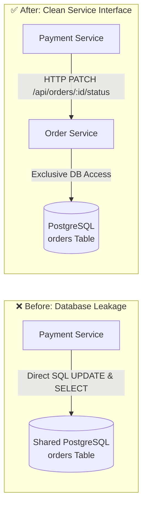
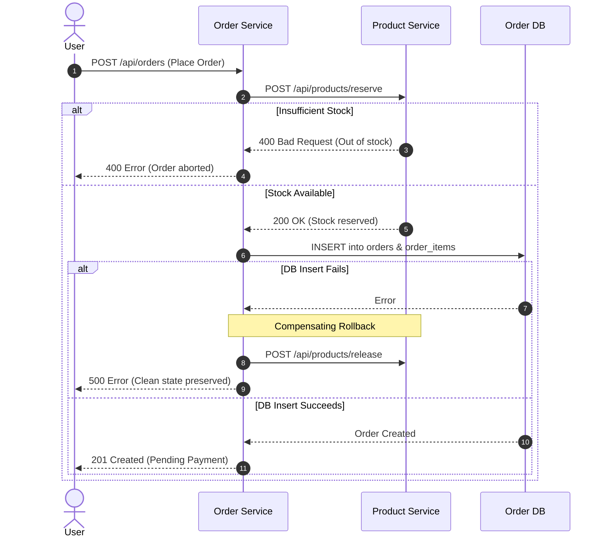
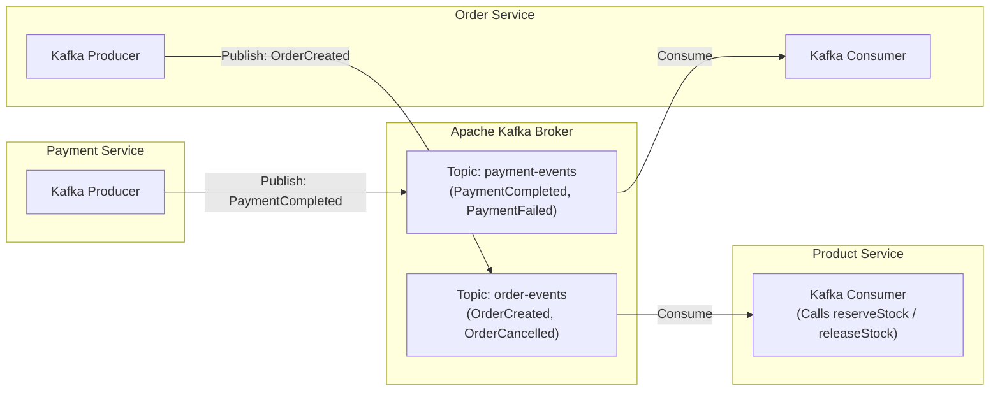
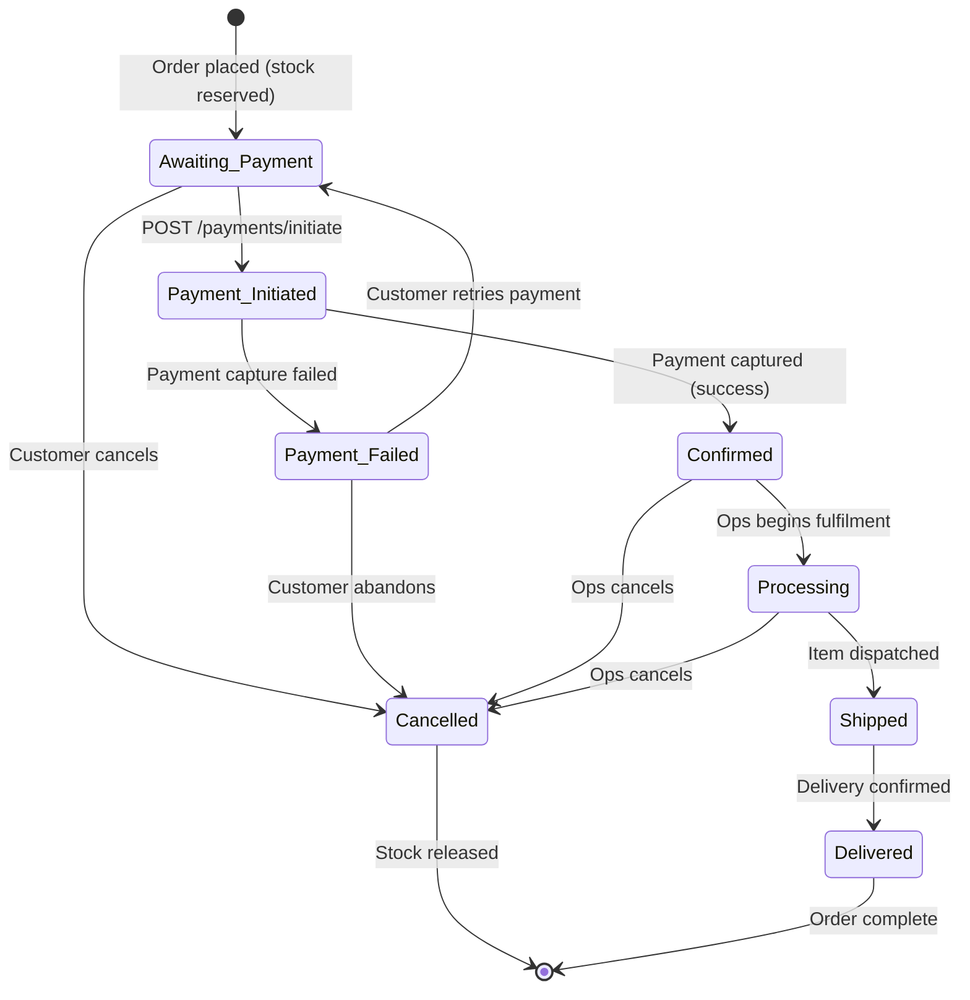
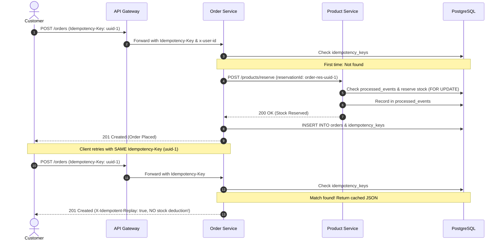

# 🏗️ Architectural Prerequisites for Event-Driven Architecture (Kafka)

This document explains the architectural rationale and implementation details behind the two foundational features implemented prior to introducing Apache Kafka into this microservices platform:

1. **Feature 1: Service Boundary Decoupling (Resolving Database Leakage)**
2. **Feature 2: Atomic Stock & Inventory Management (Saga Pattern Readiness)**
3. **Feature 3: Order Status State Machine (Canonical Lifecycle Alignment)**
4. **Feature 4: Distributed Idempotency & Deduplication Engine (Idempotent Consumer & Producer)**

---

## 📑 Table of Contents
- [Executive Overview](#executive-overview)
- [Feature 1: Service Boundary Decoupling](#feature-1-service-boundary-decoupling)
  - [The Problem (Distributed Monolith Anti-Pattern)](#the-problem-distributed-monolith-anti-pattern)
  - [Why This Blocked Kafka](#why-this-blocked-kafka)
  - [What Was Implemented](#what-was-implemented)
  - [Before vs. After Workflow](#before-vs-after-workflow)
- [Feature 2: Stock & Inventory Management](#feature-2-stock--inventory-management)
  - [The Problem (Missing Business State & Overselling)](#the-problem-missing-business-state--overselling)
  - [Why This Blocked Kafka](#why-this-blocked-kafka-1)
  - [What Was Implemented](#what-was-implemented-1)
  - [The Saga Compensating Rollback](#the-saga-compensating-rollback)
- [How These Two Features Transition to Kafka](#how-these-two-features-transition-to-kafka)
  - [Current Synchronous Flow (HTTP)](#current-synchronous-flow-http)
  - [Next Step: Asynchronous Event Flow (Kafka)](#next-step-asynchronous-event-flow-kafka)
- [Feature 3: Order Status State Machine](#feature-3-order-status-state-machine)
  - [The Problem (Inconsistent and Undeclared States)](#the-problem-inconsistent-and-undeclared-states)
  - [Why This Blocked Kafka](#why-this-blocked-kafka-2)
  - [What Was Implemented](#what-was-implemented-2)
  - [The State Machine](#the-state-machine)
- [Summary of Modified Files](#summary-of-modified-files)

---

## Executive Overview

Before introducing an event streaming broker like Apache Kafka, a microservices system must have **clear domain boundaries** and **meaningful domain events**. 

Introducing Kafka into a system with shared database mutations or missing business state creates accidental complexity without the benefits of distributed event-driven systems.

```
┌────────────────────────────────────────────────────────┐
│               The Evolution Journey                    │
│                                                        │
│   Distributed Monolith  ───►  Clean REST Boundaries   │
│   (Shared DB Queries)          (Explicit Interfaces)   │
│                                           │            │
│                                           ▼            │
│                               Event-Driven Platform    │
│                               (Kafka Pub/Sub + Saga)   │
└────────────────────────────────────────────────────────┘
```

---

## Feature 1: Service Boundary Decoupling

### The Problem (Distributed Monolith Anti-Pattern)
In the initial codebase, all services connected to the same PostgreSQL database instance. While sharing a physical database engine in development is common, **services were querying and mutating each other's tables directly**:

* `payment-service` was running SQL `SELECT` queries on the `orders` table to check totals and customer ownership.
* `payment-service` was running SQL `UPDATE` queries directly on the `orders` table to change order status to `'Pending_Payment'`, `'Paid'`, and `'Payment_Failed'`.
* `payment-service` was running a SQL `JOIN` across `payments` and `orders` to display payment history.

This created a **tight temporal and spatial coupling**: `order-service` had no control over its own table invariants, and schema changes in `orders` would silently break `payment-service`.

### Why This Blocked Kafka
Kafka is fundamentally an **Event-Driven messaging bus**:
* An event is a statement of fact: *"Payment #123 Completed"*.
* The owner of the domain (`order-service`) consumes that fact and updates its own state.

If `payment-service` continues to directly mutate the `orders` table via SQL, there is no technical purpose for Kafka. Introducing Kafka while maintaining direct cross-database queries results in the worst of both worlds: message queuing overhead on top of database coupling.

### What Was Implemented

1. **Isolated Service Responsibilities:**
   * `order-service` is now the **sole authority** over the `orders` and `order_items` tables.
   * `payment-service` is the **sole authority** over the `payments` table.

2. **Replaced Direct SQL with HTTP API Invocations:**
   * In `paymentController.initiatePayment`: Replaced `SELECT ... FROM orders` with a call to `GET ${ORDER_SERVICE_URL}/api/orders/:id`.
   * In `paymentController.processPayment`: Replaced direct `UPDATE orders` with a call to `PATCH ${ORDER_SERVICE_URL}/api/orders/:id/status`.

3. **Autonomous Payment History:**
   * Removed the cross-table SQL `JOIN` in `getPaymentHistory`. Since the `payments` table stores `amount` at the moment of payment intent creation, `payment-service` serves history entirely from its own table.

4. **Internal Service Authorization:**
   * Updated `order-service`'s `updateOrderStatus` endpoint to recognize internal service-to-service calls using the header `x-internal-service: payment-service`.

5. **Formalized Database Schema:**
   * Added the formal `CREATE TABLE payments` DDL and updated `order_status_enum` in `schema.sql`.

### Before vs. After Workflow



---

## Feature 2: Stock & Inventory Management

### The Problem (Missing Business State & Overselling)
Before this implementation:
* `product-service` only possessed a single read endpoint (`GET /api/products`).
* When a user placed an order via `order-service`, the platform calculated price totals and inserted rows into `orders` and `order_items`, but **stock was never checked and never decremented**.
* If 50 users simultaneously ordered an item with only 2 units in stock, all 50 orders would succeed, causing massive stock desynchronization and overselling.

### Why This Blocked Kafka
The most critical distributed pattern in modern microservices is the **Saga Pattern (Choreography)**:
* A distributed transaction cannot use database-level two-phase locking across multiple services.
* Instead, it relies on **forward actions** and **compensating rollback actions**:
  1. Reserve inventory.
  2. If payment succeeds $\rightarrow$ Confirm order.
  3. If payment fails $\rightarrow$ Execute compensating action: **Release reserved inventory back to the shelf**.

Without stock deduction and stock release functions, an event-driven Saga has nothing to execute or roll back.

### What Was Implemented

1. **Atomic Stock Reservation (`POST /api/products/reserve`):**
   * Accepts `{ items: [{ productId, quantity }] }`.
   * Executes inside a PostgreSQL transaction (`BEGIN ... COMMIT`).
   * Employs **row-level locking (`SELECT ... FOR UPDATE`)** to prevent race conditions during concurrent checkouts.
   * Validates `stock >= quantity`. If any item is insufficient, the transaction immediately rolls back and returns a descriptive error message with available quantities.
   * Evicts the Upstash Redis catalog cache (`products:all`) so real-time stock levels are immediately served to users.

2. **Compensating Stock Release (`POST /api/products/release`):**
   * Accepts `{ items: [{ productId, quantity }] }`.
   * Atomically adds stock back (`stock = stock + quantity`) and clears the Redis catalog cache.

3. **Single Product Inspection (`GET /api/products/:id`):**
   * Retrieves single product attributes and live stock availability.

### The Saga Compensating Rollback

In `order-service` ([orderController.js](file:///e:/microservice/order-service/src/controllers/orderController.js)):
* **Pre-order Reservation:** Before creating the database record, `order-service` calls `POST /api/products/reserve`.
* **Compensating Rollback:** If PostgreSQL fails while inserting the order or items, the `catch` block automatically executes a compensating action by calling `POST /api/products/release`, ensuring no inventory is locked permanently by ghost orders.
* **Cancellation Release:** When an order transitions to `'Cancelled'` or `'Payment_Failed'`, `order-service` triggers `release` to return items to inventory.



---

## How These Two Features Transition to Kafka

By implementing clean boundary interfaces first, introducing Apache Kafka now becomes a clean **1:1 replacement** of synchronous HTTP calls with asynchronous event streams.

### Current Synchronous Flow (HTTP)
Currently, services communicate via direct point-to-point HTTP:

```
[Order Service]   ─── HTTP POST /reserve ───►  [Product Service]
[Payment Service] ─── HTTP PATCH /status ───►  [Order Service]
```

### Next Step: Asynchronous Event Flow (Kafka)
With Kafka, point-to-point HTTP calls are replaced by publishing and subscribing to topics:



1. **`OrderCreated` event published to `order-events`:**
   * `product-service` consumes this event and calls the exact `reserveStock()` logic we just built.
2. **`PaymentCompleted` event published to `payment-events`:**
   * `order-service` consumes this event and calls the exact `updateOrderStatus()` logic we just built.
3. **`PaymentFailed` event published to `payment-events`:**
   * `product-service` consumes this event and calls `releaseStock()` to return items to the store.

---

## Feature 3: Order Status State Machine

### The Problem (Inconsistent and Undeclared States)

Before this implementation, order statuses were scattered, inconsistent plain strings:
* The `schema.sql` enum defined: `'Placed'`, `'Processing'`, `'Shipped'`, `'Delivered'`, `'Cancelled'`
* The `order-service` controller inserted orders with: `'Pending_Payment'`
* The `payment-service` controller updated orders to: `'Paid'`, `'Payment_Failed'` and `'Pending_Payment'`

Three separate files defined order status values independently as magic strings. Because the enum in the database was never updated to include `'Pending_Payment'` or `'Paid'`, any real database enforced with the enum would **reject these inserts** at the SQL level.

Additionally, there were **no guards against illegal state transitions**. Any caller could request `PATCH /api/orders/:id/status` and move an order from `'Delivered'` back to `'Awaiting_Payment'`, or from `'Cancelled'` to `'Processing'`.

### Why This Blocked Kafka

Kafka events describe **things that happened**: `PaymentCompleted`, `OrderShipped`. Each event triggers a state transition. If the state machine has no enforcement, the same event processed twice (Kafka's at-least-once delivery) could trigger the same transition twice — producing a double-transition, a double stock release, or a duplicate confirmation email.

A **canonical, centrally-defined, validated state machine** is the guard that makes Kafka consumer logic **idempotent and safe**.

### What Was Implemented

1. **Central `orderStatus.js` Config File** ([`order-service/src/config/orderStatus.js`](file:///e:/microservice/order-service/src/config/orderStatus.js)):
   * Defines `ORDER_STATUS` — a frozen constant object as the single source of truth for all valid statuses.
   * Defines `PAYMENT_STATUS` — constants for `payment-service` payment record states.
   * Defines `VALID_TRANSITIONS` — a map from every status to the array of statuses it may legally transition to.
   * Defines `STOCK_RELEASE_STATUSES` — a `Set` of statuses that trigger stock to be returned to inventory.
   * Exports `isValidTransition(currentStatus, nextStatus)` — returns `true`/`false`.
   * Exports `requiresStockRelease(newStatus)` — returns `true`/`false`.

2. **Updated `schema.sql` Enum** — Aligned the PostgreSQL `order_status_enum` with the canonical set, with inline comments describing each state's meaning.

3. **State Machine Validation in `updateOrderStatus`** — Before any `UPDATE orders SET status = ...`, the controller now:
   * Validates the requested status exists in `ORDER_STATUS`.
   * Calls `isValidTransition(order.status, status)` and returns `HTTP 409 Conflict` with the current status, the rejected status, and the list of allowed transitions if the transition is illegal.

4. **Automatic Stock Release on State Change** — Uses `requiresStockRelease(status)` to trigger stock release only on transitions to `Payment_Failed` or `Cancelled`, replacing fragile equality checks with a data-driven `Set` lookup.

5. **Aligned `payment-service` statuses**:
   * `'Paid'` → renamed to `'Confirmed'`
   * `'Pending_Payment'` → renamed to `'Payment_Initiated'`

### The State Machine



---

## Feature 4: Distributed Idempotency & Deduplication Engine

### The Problem (Duplicate Events & Retry Hazards)

In any distributed event-driven system, **at-least-once delivery** is guaranteed, but network hiccups, consumer rebalances, worker crashes, or user double-clicks will inevitably cause the exact same request or event to be processed more than once:

1. **Client Double Checkout:** A customer double-clicks "Proceed to Checkout" or their mobile connection drops $\rightarrow$ two orders are created and stock is deducted twice.
2. **Duplicate Kafka Events:** A Kafka broker redelivers an `OrderCreated` or `PaymentCompleted` event during a rebalance $\rightarrow$ `product-service` deducts inventory twice or `payment-service` attempts multiple captures.

### Why This Blocked Kafka

Kafka does not guarantee exactly-once processing across database boundaries on its own. If downstream microservice consumers lack an **Idempotent Consumer / Inbox pattern**, processing duplicate events results in data corruption (oversold stock and duplicate billing).

### What Was Implemented

Feature 4 introduces a **Two-Tier Idempotency Engine**:

#### Tier 1: Client HTTP Idempotency Key Pattern (`order-service`)
1. **Database Table `idempotency_keys`**:
   - Stores `(key, user_id, endpoint, response_status, response_body)`.
2. **Middleware (`order-service/src/middleware/idempotencyMiddleware.js`)**:
   - Intercepts requests bearing the `Idempotency-Key: <UUID>` header.
   - If key exists for the user, immediately short-circuits and replays the cached response with `X-Idempotent-Replay: true` without hitting business logic or deducting stock.
   - If first occurrence, allows execution, captures `res.json`, and records the response atomically.
3. **Frontend Integration (`frontend/src/App.jsx`)**:
   - Generates a `crypto.randomUUID()` upon clicking "Proceed to Checkout" and passes `Idempotency-Key` in request headers.

#### Tier 2: Consumer Event Deduplication (`product-service`)
1. **Database Table `processed_events`**:
   - Stores `(event_id, event_type, consumer_service, response_payload)` with a unique constraint on `(event_id, consumer_service)`.
2. **Idempotent Stock Reservation & Release**:
   - `reserveStock` and `releaseStock` check `processed_events` before locking rows.
   - If `reservationId` was already handled, it returns the cached result without modifying stock.
   - Writes to `processed_events` atomically inside the same database transaction (`BEGIN ... COMMIT`).



---

## Summary of Modified Files

| File | Change Overview |
| :--- | :--- |
| [`schema.sql`](file:///e:/microservice/schema.sql) | Added `CREATE TABLE payments`, `idempotency_keys`, `processed_events`, and updated `order_status_enum`. |
| [`order-service/src/middleware/idempotencyMiddleware.js`](file:///e:/microservice/order-service/src/middleware/idempotencyMiddleware.js) | **New.** Intercepts `Idempotency-Key`, returns cached responses on duplicates, and persists successful responses. |
| [`order-service/src/routes/orderRoutes.js`](file:///e:/microservice/order-service/src/routes/orderRoutes.js) | Applied `idempotencyMiddleware` on `POST /api/orders`. |
| [`order-service/src/controllers/orderController.js`](file:///e:/microservice/order-service/src/controllers/orderController.js) | Forwards `idempotencyKey` to `product-service` as `reservationId` and `releaseId`. |
| [`product-service/src/controllers/productController.js`](file:///e:/microservice/product-service/src/controllers/productController.js) | Integrated `processed_events` deduplication into `reserveStock` and `releaseStock`. |
| [`api-gateway/src/app.js`](file:///e:/microservice/api-gateway/src/app.js) | Added `idempotency-key` to CORS allowed headers. |
| [`api-gateway/src/routes/proxyRoutes.js`](file:///e:/microservice/api-gateway/src/routes/proxyRoutes.js) | Forwards client `Idempotency-Key` headers to `order-service` and `payment-service`. |
| [`frontend/src/App.jsx`](file:///e:/microservice/frontend/src/App.jsx) | Generates `crypto.randomUUID()` on checkout; added instant keyword search bar across storefront and inventory. |


